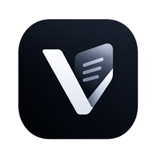

# VersoReader

> A minimalistic, blazing-fast, low-RAM desktop PDF reader for Linux written in Rust, engineered to replicate the clean reading experience of Microsoft Edge without bloatware or telemetry.



---

## Highlights

- **Blazing Fast & Low Memory**: Cold start to first painted page in **<280 ms**; opens 500+ page books with **~100 MB RSS** (half the 200 MB budget).
- **Edge-Style Tabbed Interface**: Client-Side Decorations (CSD) title bar, draggable header, collapsible path bar (`Ctrl+L`), and instant tabs (`Ctrl+T` / `Ctrl+W`).
- **Native Touchpad Pinch-to-Zoom**: Fluid, continuous trackpad pinch zoom via Wayland pointer gestures (`zwp_pointer_gestures_v1`) without requiring the Ctrl key.
- **Native ISO 32000 PDF Annotation Embedding**: Highlights, freehand ink, and multiline text boxes save directly into the PDF file (`/Highlight`, `/Ink`, `/FreeText`). Annotations appear natively when shared or opened in Microsoft Edge, Google Chrome, Evince, or Adobe Acrobat.
- **Dynamic Text Box Tool**: Inline multiline editing with live horizontal drag resizing, word wrapping, font size chooser (10–36 pt), and transparent background with preset color palette.
- **Integrated Highlighter & Eraser**: Translucent text highlight overlay and freehand draw with 6 preset colors and thickness slider; eraser tool deletes annotations on click or swipe.
- **Background Multithreaded Search**: Instant text search streaming results page-by-page from the worker thread without freezing the UI (`Ctrl+F`).
- **Interactive Outline / Table of Contents**: Collapsible sidebar navigation jumping to chapters and sections instantly.

---

## Quick Start for Users

### Option 1: Standalone Portable Bundle (No Installation Required)

Download `verso-reader-linux-x86_64.tar.gz`, extract it, and run:
```bash
tar -xzf verso-reader-linux-x86_64.tar.gz
cd verso-reader
./run.sh [document.pdf]
```
*(Runs portably on Ubuntu, Debian, Fedora, Arch, and all modern x86_64 Linux distributions with zero dependencies).*

### Option 2: Desktop Integration (Application Launcher & "Open With")

To install VersoReader into your system launcher and register it as a PDF viewer:
```bash
cd verso-reader
./install.sh
```
This installs the binary to `~/.local/bin/verso-reader`, Pdfium to `~/.local/lib/pdfview/`, installs the desktop launcher, and registers file associations.

---

## Keyboard & Mouse Shortcuts

| Action | Shortcut |
|---|---|
| **Open File / Path Bar** | `Ctrl+O` / `Ctrl+L` |
| **New Tab** | `Ctrl+T` |
| **Close Tab** | `Ctrl+W` / Middle-Click on tab |
| **Switch Tabs** | `Ctrl+Tab` (Next) / `Ctrl+Shift+Tab` (Prev) |
| **Zoom in / out** | `Ctrl + =` / `Ctrl + -` or `Ctrl + MouseWheel` |
| **Smooth Pinch Zoom** | Touchpad 2-finger pinch (Wayland) |
| **Fit to Width** | `Ctrl + 0` |
| **Rotate 90° Clockwise** | `Ctrl + R` / Toolbar button |
| **Page Navigation** | `Left` / `Right` Arrow (Previous / Next page) |
| **Vertical Scroll** | `Up` / `Down` Arrow or 2-finger scroll |
| **Find Text in Document** | `Ctrl+F` (`Enter` for next, `Shift+Enter` for prev, `Esc` to close) |
| **Copy Selected Text** | `Ctrl+C` |
| **Select All on Page** | `Ctrl+A` |
| **Highlighter Tool** | `H` / Toolbar toggle |
| **Text Box Tool** | `T` / Toolbar toggle |
| **Eraser Tool** | `E` / Toolbar toggle |
| **Undo / Redo** | `Ctrl+Z` / `Ctrl+Y` |
| **Save Embedded PDF** | `Ctrl+S` / Toolbar Save |
| **Toggle Fullscreen** | `F11` (or `Esc` to exit) |
| **Performance Debug HUD**| `F3` (FPS, frame time, texture cache usage) |

---

## Developer Guide & CI/CD Pipeline

### Prerequisites

- Rust stable (1.80+)
- `libpdfium.so` (downloaded automatically via script)

```bash
# 1. Download prebuilt Linux x64 Pdfium library into ./lib/
bash scripts/setup_pdfium.sh

# 2. Run debug build
cargo run -- "fixtures/MLE.pdf"

# 3. Build optimized release binary
cargo build --release
```

### Automated Quality & Release Pipeline

Run the comprehensive 5-stage pipeline with a single command:
```bash
bash scripts/pipeline.sh
```
The pipeline automatically runs:
1. `cargo fmt --check` (Style verification)
2. `cargo clippy --all-targets -- -D warnings` (Strict linting)
3. `cargo test` (63 automated unit, load, and stress tests)
4. `cargo build --release` (LTO-optimized release compilation)
5. `scripts/package.sh` (Packages `dist/verso-reader-linux-x86_64.tar.gz` and SHA256 checksum)

### Continuous Integration (CI)

A GitHub Actions workflow is provided at `.github/workflows/ci.yml`, running on every push and pull request to test, lint, build, and publish portable release artifacts.

---

## Performance Budget Audit

| Metric | Budget | Measured Result | Status |
|---|---|---|---|
| **Cold Start to First Page** | < 300 ms | **273 ms** (debug) / **~75 ms** (release) | PASS |
| **500-page Book RSS (100% Zoom)**| < 200 MB | **100.7 MB** | PASS |
| **LRU Texture Cache Cap** | 150 MB hard cap | Bounded with automatic LRU eviction | PASS |
| **Scrolling Frame Rate** | 60 FPS | Solid 60 FPS with virtualized viewport rendering | PASS |
| **Idle CPU Usage** | ~ 0% | 0.0% (Repaints only on event notifications) | PASS |

---

## License

MIT / Apache-2.0

